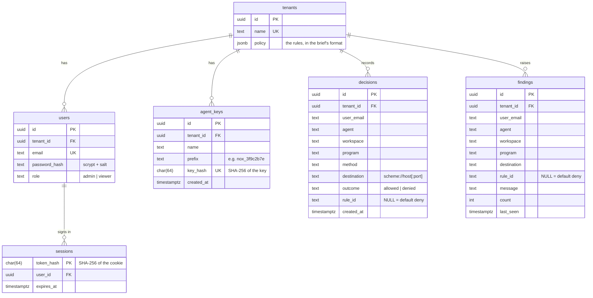

# Database

Six Postgres tables, created by one migration
([src/database/migrations](../src/database/migrations)) on startup.



| Table        | One row per        | Why it exists                                                       |
| ------------ | ------------------ | ------------------------------------------------------------------- |
| `tenants`    | company            | Owns everything else. Holds its one policy.                         |
| `users`      | admin or viewer    | Signs in. `role` says if they can change things.                    |
| `sessions`   | signed-in browser  | Lets sign-out end a session on the server                           |
| `agent_keys` | key                | Tells us which tenant an agent belongs to. Revoke = delete the row. |
| `decisions`  | answer to an agent | "Every decision is recorded"                                        |
| `findings`   | problem            | What the admin reads. Retries raise `count`.                        |

## Keys

- **`tenants.id`, `users.id`, `agent_keys.id`, `decisions.id`, `findings.id`** are generated
  UUIDs, so they can't be guessed or counted. `agent_keys.id` is what the UI uses to revoke a key,
  so the hash never leaves the server.
- **`users.email`** is unique, so sign-in is by email alone. **`users.role`** is `admin` or
  `viewer`, enforced by a `CHECK` constraint.
- **`agent_keys.key_hash`** is unique and **`sessions.token_hash`** is the primary key. Every
  request looks them up by hash.
- **`findings`** has a unique key on the problem itself:

  ```sql
  UNIQUE NULLS NOT DISTINCT (tenant_id, user_email, agent, workspace, program, destination, rule_id)
  ```

  That's who + what + why. A retry hits the same key, so it updates the row:

  ```sql
  INSERT INTO findings (...) VALUES (..., 1, now())
  ON CONFLICT (tenant_id, user_email, agent, workspace, program, destination, rule_id)
  DO UPDATE SET count = findings.count + 1, last_seen = now();
  ```

  Postgres checks and updates in one step, so even retries that arrive at the same moment stay one
  row. `NULLS NOT DISTINCT` makes two default denies (`rule_id` NULL) count as the same problem.

- **One index:** `findings (tenant_id, last_seen DESC)`, for the admin's list. Nothing reads
  `decisions` yet, so it has no extra index.

## Tenant isolation

Every table hangs off `tenants`. The tenant is never read from a request: it comes from the agent
key (`agent_keys.tenant_id`) or the signed-in user (`users.tenant_id`), and every query filters
by it.

## What's not stored

- **Passwords**: only a scrypt hash with a random salt.
- **Agent keys and session tokens**: only SHA-256. They're long random values, so a fast hash is
  safe. A copy of the database can't be used to sign in or call the API.
- **The full URL**: only `scheme://host[:port]`. The path and query often hold tokens or file names.
- **Read or write**: it comes from `method`, so it isn't stored twice.
- **Anything the brief doesn't ask for**: a finding has who, what (program, destination), why
  and when (`last_seen`), plus the count and the message the agent got. No first-seen time, no
  read/write split.

## Choices

- **The policy is a column on `tenants`, not its own table.** The brief gives each tenant exactly
  one policy, and every record belongs to exactly one tenant. A policy shared between tenants would
  break that: one admin's edit would change another company's rules. To reuse a policy, copy it
  as a template when the tenant is created.
- **JSON for the rules**, not a rules table. The policy is always read whole and evaluated in
  memory, and JSON keeps the brief's format exactly.
- **Findings copy their fields** instead of pointing at decisions, so the admin's list is one
  simple query.
- **Text, not enums**, for `outcome`. The values are checked in code, and a new one
  (like `held` from the bonus) needs no migration.
